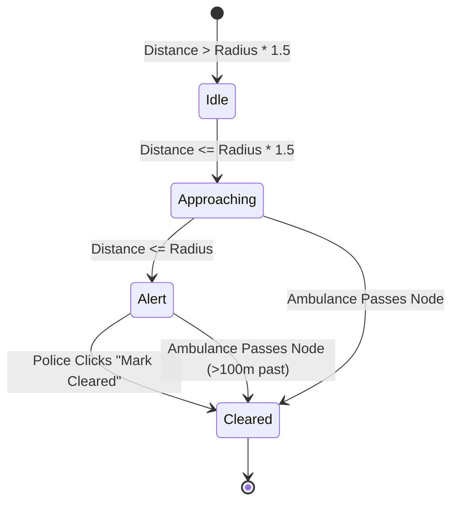

# Vaayu: GPS-Based Ambulance Priority Signal Management

**Vaayu** (Sanskrit for *Wind*) is an intelligent emergency-vehicle priority signal clearance prototype. It simulates an ambulance traversing a high-density transit corridor in Hyderabad, India, continuously computing proximity against registered traffic junctions. When the ambulance breaches a junction's alert radius, the system transmits real-time priority alerts to responsible traffic police officers so they can preemptively clear the junction before the vehicle arrives.

---

## Architecture & Stack

- **Backend**:
  - Node.js & Express REST API
  - Real-time WebSockets via Socket.IO
  - SQLite database using `better-sqlite3` (auto-created and seeded with 8 Hyderabad corridor junctions)
  - Modular `AlertEngine` state machine & `SimulatedGpsProvider`
- **Frontend**:
  - React 19 + TypeScript + Vite
  - Tailwind CSS v4 (Emergency Command Center theme with dark navy `#0f172a` and crimson accents)
  - `react-leaflet` with OpenStreetMap raster tiles (100% free, no API keys needed)
  - Web Audio API synthesizer for instant audio sirens and clearance chimes
  - Lucide icons

---

## Directory Structure

```
vaayu/
├── package.json               # Root scripts (npm run dev via concurrently)
├── README.md                  # System documentation & hardware swap guide
├── server/
│   ├── database.js            # SQLite schema, migrations & Hyderabad seed data
│   ├── geoUtils.js            # Haversine distance, bearing, and interpolation
│   ├── gpsProvider.js         # GpsProvider base interface & SimulatedGpsProvider
│   ├── alertEngine.js         # State lifecycle engine (idle -> approaching -> alert -> cleared)
│   ├── index.js               # Express REST API & Socket.IO server
│   ├── package.json           # Server dependencies & test script
│   └── tests/
│       └── alertEngine.test.js # Unit tests for Haversine & state transitions
└── client/
    ├── src/
    │   ├── components/
    │   │   ├── Header.tsx     # Role navigation bar & "System: Simulated GPS" badge
    │   │   └── Map.tsx        # Leaflet map with animated ambulance & colored junctions
    │   ├── views/
    │   │   ├── AmbulanceView.tsx # Telemetry HUD, speed slider, multiplier (1x/5x/10x)
    │   │   ├── PoliceView.tsx    # Live alert feed, countdown ETA, Mark Cleared button
    │   │   ├── AdminView.tsx     # Click-to-add on map, edit, reorder, reset demo data
    │   │   └── LogsView.tsx      # Metrics cards, response time bar chart, CSV export
    │   ├── utils/
    │   │   └── sound.ts       # Synthesizer alert tones (Web Audio API)
    │   ├── services/
    │   │   └── socket.ts      # Socket.IO client instance
    │   └── types.ts           # Shared TypeScript interfaces
    ├── vite.config.ts
    └── package.json
```

---

## Hyderabad Demo Corridor (8 Seeded Junctions)

1. **Secunderabad Station Junction** (17.4344, 78.5011) — Insp. K. Ramesh (500m radius)
2. **Paradise Circle** (17.4428, 78.4872) — SI S. Naidu (500m radius)
3. **Begumpet Flyover Junction** (17.4442, 78.4682) — Insp. M. Varma (600m radius)
4. **Prakash Nagar Metro Junction** (17.4418, 78.4570) — SI A. Krishna (450m radius)
5. **Ameerpet Cross Roads** (17.4375, 78.4482) — Insp. G. Reddy (550m radius)
6. **Panjagutta Circle** (17.4265, 78.4511) — Insp. P. Venkatesh (500m radius)
7. **Banjara Hills Rd No 1 (City Center)** (17.4190, 78.4485) — SI B. Chandu (500m radius)
8. **Jubilee Hills Checkpost** (17.4285, 78.4125) — Insp. R. Shiva (600m radius)

---

## State Lifecycle & Priority Alert Engine

For every registered junction along the route, the alert engine calculates the Haversine distance from the ambulance at 1 Hz:

$$\text{ETA} = \frac{\text{Haversine Distance (m)}}{\text{Current Speed (m/s)}}$$



- **Idle** (Grey): Ambulance is outside the warning boundary.
- **Approaching** (Amber): Ambulance is within advisory range ($1.5 \times \text{alert\_radius\_m}$).
- **Active Alert** (Red): Ambulance enters clearance radius ($\le \text{alert\_radius\_m}$). An audio chime triggers, a notification pops up, and countdown ETA is displayed.
- **Cleared** (Green): Traffic police clears the signal, or the system auto-clears once the ambulance safely passes the junction. Response time is computed and stored.

Alerts fire **strictly once** per node per trip. Every state change is written to the SQLite `events` table.

---

## Getting Started

### 1. Install & Run Everything with One Command
From the root directory:
```bash
npm run dev
```
This concurrently starts:
- **Backend API & WebSockets** on `http://localhost:5000`
- **Frontend Vite Dev Server** on `http://localhost:5173`

Open your browser to: **`http://localhost:5173`**

### 2. Run Unit Tests
To run the automated verification test suite:
```bash
npm test
```
Tests cover:
- Great-circle Haversine distance accuracy and symmetry
- Complete state transition cycle (`idle` → `approaching` → `alert` → `cleared`)
- Idempotent alert firing (only once per node per trip)
- Manual police clearance vs automatic clearance on passing

---

## Frontend Roles & How to Test

Use the top-bar switcher to navigate between views:

1. **Ambulance View (`/ambulance`)**:
   - Click **Start Siren** to start moving the ambulance.
   - Adjust the **Speed Slider** (20 to 80 km/h) or toggle **1x / 5x / 10x** simulation multipliers for quick demos.
   - Watch the live telemetry HUD update: GPS coordinates, speed, distance remaining, next junction and live ETA.
2. **Traffic Police View (`/police`)**:
   - Filter by "All Corridor Junctions" or select "My Junction" from the dropdown.
   - When the ambulance reaches a junction radius, an audio chime plays, and a flashing red **Urgent Alert** card appears showing the distance and ETA.
   - Click **"Mark Junction Cleared"** to clear the signal. The response time will be logged immediately.
3. **Admin View (`/admin`)**:
   - Click anywhere on the map to automatically populate latitude and longitude into the form.
   - Add, edit, or delete junctions. Use the **Up/Down arrows** to reorder the corridor sequence.
   - Click **"Reset Demo Data"** to restore the default 8 Hyderabad junctions.
4. **Logs & Analytics (`/logs`)**:
   - Inspect KPI cards: Total Trips, Average Clearance Response Time, Alerts per Trip, and Cleared Pre-Arrival.
   - View the **Response Time per Junction** bar chart.
   - Filter and search the audit event table.
   - Click **"Export CSV"** to download the complete event history.

---

## Swapping Simulated GPS for Live Hardware & Road Routing

The codebase includes an abstract `GpsProvider` interface (`server/gpsProvider.js`) engineered for plug-and-play swapping:

### Swapping for Hardware GPS (e.g. NEO-6M / SIM800L / ESP32)
1. Replace `SimulatedGpsProvider` with a `HardwareGpsProvider` extending `GpsProvider`.
2. Connect to the GPS module via Serial UART (`serialport` npm package) or Cellular MQTT broker.
3. Parse standard NMEA `$GPRMC` sentences (extracting latitude, longitude, and speed in knots converted to km/h).
4. Emit `this.emitLocation({ lat, lng, speed, ... })` whenever a new satellite fix is received.

### Dynamic Street-Level Routing (OSRM / Google Directions)
Instead of linear segment interpolation:
1. Query the [OSRM Route Service](http://project-osrm.org/docs/v5.24.0/api/#route-service) with the ordered junction coordinates:
   ```http
   GET http://router.project-osrm.org/route/v1/driving/{lng1},{lat1};{lng2},{lat2}?overview=full&geometries=geojson
   ```
2. Feed the returned GeoJSON polyline coordinates directly into `SimulatedGpsProvider.setNodes()`.
